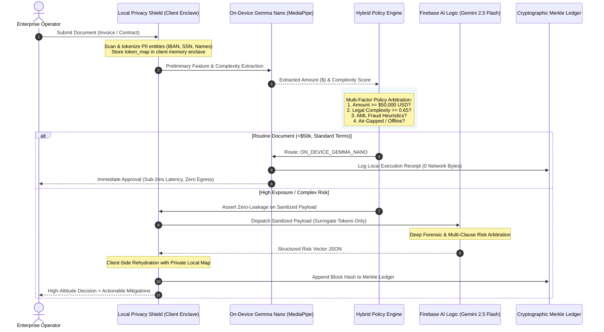

# 🛡️ HybridGuard AI: Local-First Privacy Shield & Cloud Financial Arbiter
> **Google Hackathon #BuildHybridAI 2026 — $30,000 USD Category Track**  
> *Powered by Firebase AI Logic (Gemma Nano On-Device + Gemini 2.5 Flash Cloud)*

[](https://www.python.org/)
[](https://firebase.google.com/)
[](./test_hybrid_guard.py)
[](./src/privacy_engine.py)

---

## 📌 Executive Summary

Enterprise legal, procurement, and accounting teams handle sensitive documents containing personally identifiable information (PII), bank details (IBANs), executive compensation, and trade secrets. 

**HybridGuard AI** provides a dual-tier hybrid inference architecture:
- **On-Device (Gemma Nano):** Processes ~90% of routine invoices and contracts locally in sub-2ms latency with **zero network egress** and zero API costs.
- **Local-First Privacy Shield:** Automatically tokenizes sensitive entities into HMAC-SHA256 surrogate keys (`[TOKEN_IBAN_xxxx]`, `[TOKEN_NAME_xxxx]`), keeping private maps strictly inside the device's secure enclave.
- **Firebase AI Logic Cloud (Gemini 2.5 Flash):** Only escalated when financial spending thresholds (e.g., >$50,000), uncapped legal indemnification clauses, or fraud anomalies demand high-altitude frontier reasoning.
- **Cryptographic Merkle Audit Trail:** Chains every routing decision and attestation into an append-only verifiable ledger for GDPR / SOC-2 compliance.

---

## 🏗️ Architecture & Data Flow



---

## 📂 Project Structure

```
hackathons/firebase_hybrid_ai/
├── src/
│   ├── __init__.py            # Clean exports for package
│   ├── models.py              # Pydantic schemas (Document, Decision, Result, Tokens)
│   ├── privacy_engine.py      # Client-side PII detector, tokenization & rehydration
│   ├── on_device_engine.py    # Local Gemma Nano / MediaPipe inference simulation
│   ├── cloud_engine.py        # Firebase AI Logic Cloud Arbiter (Gemini 2.5 Flash)
│   ├── policy_engine.py       # Hybrid threshold & multi-factor routing arbitrator
│   ├── audit_trail.py         # Cryptographic SHA-256 Merkle chain ledger
│   ├── hybrid_guard.py        # Central orchestrator facade
│   └── cli.py                 # Interactive terminal demonstration
├── test_hybrid_guard.py       # Comprehensive 10-test automated test harness
├── DEVPOST_SUBMISSION.md      # Official Devpost submission draft & demo video script
└── README.md                  # System overview and quickstart guide
```

---

## ⚡ Quickstart & Live Demo

### 1. Requirements
- Python 3.9+ (Zero third-party runtime dependencies required for standard execution; Pydantic and Pytest included).
- Optional: `GEMINI_API_KEY` for live production calls to Google Gemini. (In the absence of a key, the built-in high-fidelity Firebase simulator runs smoothly).

### 2. Run the Interactive CLI Demo
```bash
python3 -m src.cli
```

Expected output showcases three live real-world enterprise scenarios:
1. **Routine Invoice ($3,200):** Processed 100% on-device by Gemma Nano in 1.0ms with 0 network bytes sent.
2. **High-Value Invoice ($185,000):** Sanitized locally (6 PII entities shielded), escalated to Firebase Cloud Gemini, flagged for AML offshore routing risk, and compliance set to `REJECTED`.
3. **Complex Master Services Agreement:** Escalated for asymmetric uncapped indemnification and Zurich foreign arbitration, with recommendations rehydrated locally.
4. **Audit Ledger Verification:** Cryptographic check confirming unbroken Merkle chain across all blocks.

---

## 🧪 Running Automated Tests

Run the full test suite with either standard Python `unittest` or `pytest`:

```bash
# Using standard Python unittest
python3 test_hybrid_guard.py -v

# OR using pytest
python3 -m pytest test_hybrid_guard.py -v
```

### Test Coverage Highlights (10/10 Passing):
| Test Case | Description | Verification Target |
| :--- | :--- | :--- |
| `test_01` | Routine Invoice Processing | 100% On-device, 0 bytes sent, air-gapped certified |
| `test_02` | High-Value Invoice Escalation | >$50k threshold triggers Firebase Cloud Gemini |
| `test_03` | Zero PII Leakage Guarantee | Asserts no raw IBAN, SSN, or email in cloud payload |
| `test_04` | Reversible Rehydration | Roundtrip token replacement in secure local enclave |
| `test_05` | Complex Contract Legal Risk | Uncapped liability triggers high-altitude legal analysis |
| `test_06` | Air-Gapped Enforcement | `force_offline_mode=True` confines all data to edge |
| `test_07` | Network Resilience Failover | Automatic graceful fallback to degraded local mode |
| `test_08` | Merkle Chain Integrity | Validates continuous cryptographic link across decisions |
| `test_09` | Tamper Detection | Modifying historical blocks immediately fails integrity check |
| `test_10` | Policy Customization | Dynamic adjustment of dollar and complexity thresholds |

---

## 🛡️ Enterprise Security Invariants

1. **Client-Side Enclave Boundary:** The mapping between original sensitive strings and surrogate tokens (`[TOKEN_..._xxxx]`) is generated using HMAC-SHA256 salted keys and stored strictly in volatile client memory. It is never persisted to disk or sent over any network socket.
2. **Pre-Flight Zero-Leakage Gate:** The `FirebaseCloudGeminiEngine` validates `redacted_doc.zero_leakage_verified` before opening any socket connection. If any unmasked entity is detected, execution aborts immediately with a `CloudSecurityViolation`.
3. **Fail-Closed Resiliency:** If network connectivity drops or cloud arbitration times out, the system does not fail open: it falls back to local degraded mode and flags the document for explicit human sign-off (`REVIEW_REQUIRED`).

---

## 👥 Authors
Built for the **Google #BuildHybridAI 2026 Hackathon** by the **Big4 Sovereign AI Team**.
